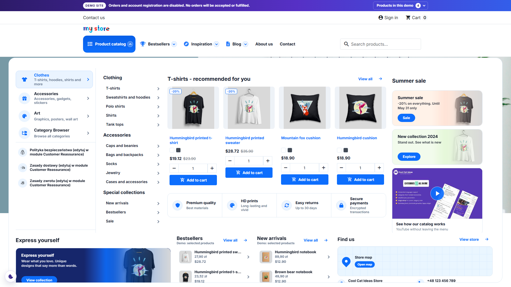
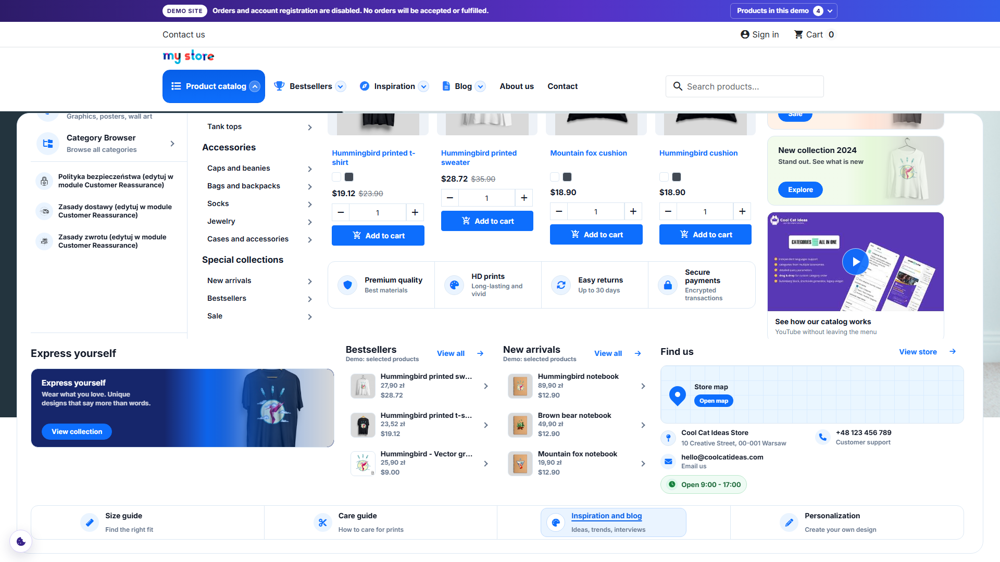

# CCI Nice Menu

Build a PrestaShop menu from categories, products, CMS pages and custom links. Use the visual editor to arrange the top navigation and its dropdown content for desktop and mobile.

[Product and download](https://coolcatideas.com/products/cci-nice-menu/) · [User guide](docs/USER_GUIDE.md) · [Online documentation](https://coolcatideas.com/docs/cci-nice-menu/1.0.0/) · [Support](#support)

## See what you can build

### Help shoppers explore the catalogue

Group category links into columns so customers can browse the shop from its header. This Pro example combines category navigation, product cards and promotional banners in one dropdown.

### Bring useful content into the menu with Pro

Keep collection links, product recommendations and store contact details within reach. The same dropdown can include a video preview, a map and links to buying or care guides.

These screenshots show CCI Nice Menu with Pro enabled. The base module provides one top-header menu with standard navigation links. Product panels, media blocks and the richer layouts shown above require Pro.

## Build the first menu

1. Install `cci_nice_menu-1.0.0.zip` in **Modules > Module Manager**.
2. Open **Cool Cat Ideas > CCI Nice Menu**.
3. Edit the menu created during installation or add a new one.
4. Add the top-level items in **Header navigation bar**.
5. Add rows, columns and links in **Storefront dropdown editor**.
6. Save and test every item on desktop and mobile.

If the menu is missing, check that the menu is active, its position is `displayTop` and the theme renders that hook. Clear the PrestaShop cache after changing hook positions.

The base module works without a license key. CCI Nice Menu Pro is optional and adds more menu definitions, Multistore tools, richer storefront blocks and image selection from the shop.

Documentation: https://coolcatideas.com/docs/cci-nice-menu/1.0.0/

## Configure and customize

- [Build a menu and adjust its width, spacing and mobile breakpoint](docs/USER_GUIDE.md).
- [Change theme CSS and preserve mobile template behavior](docs/TEMPLATES_AND_STYLING.md).
- [Create an installable Hook-node extension](docs/DEVELOPER.md#create-an-installable-menu-extension).
- [Hook arguments and examples](docs/HOOKS_REFERENCE.md) and [PHP placement integration](docs/API_REFERENCE.md).

Custom output uses a Pro Hook node. Arbitrary new node types and overrides of internal PHP methods are not supported APIs.

## Support

Use the product repository under https://github.com/orgs/cool-cat-ideas/repositories for public questions and bug reports. This channel has no guaranteed response time. When you need a private request with an agreed scope, buy a support service on the product page; the request and further messages are then handled in the Cool Cat Ideas customer panel.

Release history is available in the [changelog](CHANGELOG.md).

## Building and contributing

See [Build from source](docs/building-from-source.md) for the npm workflow. Shared components, styles and API adapters are maintained in [CCI Admin UI](https://github.com/cool-cat-ideas/cci-admin-ui).
